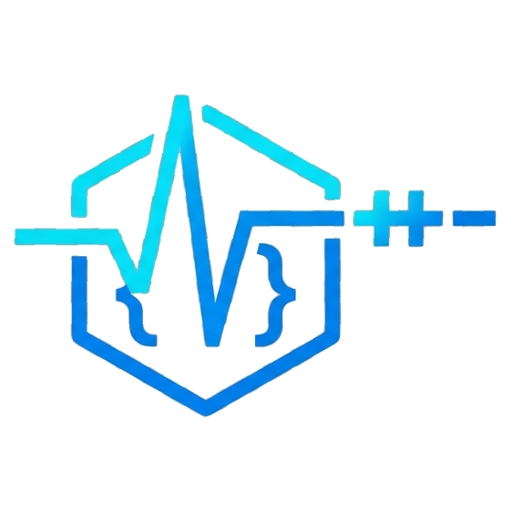

<p align="center"></p>

# WAL++ - Waveform Analysis Language

A powerful, expressive language and toolkit for analyzing digital simulation waveforms (VCD, FST, CSV) with S-expression syntax, streaming support, and Python bindings.

**WAL++ is a high-performance C++20 rewrite of the [Waveform Analysis Language (WAL)](https://wal-lang.org), originally developed in Python.** It provides the same S-expression syntax and 130+ operators, with substantially better performance and memory efficiency on large waveforms.

[](LICENSE)


[](https://wal-lang.org)

---

## Documentation

The full documentation is in [`docs/`](docs/INDEX.md).

**Start here**

- [Installation](docs/guides/installation.md)
- [**Cookbook**](docs/guides/cookbook.md) - "I want X, what do I type"
- [Getting started](docs/guides/getting-started.md)
- [Troubleshooting](docs/guides/troubleshooting.md)

**Guides**

- [Constant-time verification](docs/guides/constant-time-verification.md) - prove an instruction's latency does not depend on its data
- [Power side-channel analysis](docs/guides/power-side-channel.md) - CPA and TVLA from a simulation waveform
- [Scaling to full-core traces](docs/guides/scaling-extraction.md) - the `--fast-*` extraction modes and what they cost
- [Working with very large traces](docs/guides/large-traces.md) - streaming, and choosing between the three ways to read a trace
- [Migrating from WAL](docs/guides/migrating-from-wal.md)
- [Driving WAL++ from an agent](docs/guides/agentic-workflows.md) - JSON envelope, `inspect`, `lint`, and the loop they are for

**Building on WAL++**

- [Embedding WAL++ in a C++ program](docs/guides/cpp-api.md) - link the library, run queries, add operators
- [Writing your own extraction tool](docs/guides/writing-fast-tools.md) - a single-pass kernel, the way `--fast-hw-*` is built
- [Working examples](examples/cpp/README.md) - four programs that build against an installed WAL++

**Reference**

- [Language reference](docs/reference/language.md)
- [Command-line reference](docs/reference/cli.md)
- [Python API](docs/reference/python-api.md)
- [Compatibility with upstream WAL](docs/reference/wal-compatibility.md) - what matches, what differs and why
- [C++ API quick reference](docs/API_QUICK_REFERENCE.md) - entry points, with code

**API**

- [Generated API reference](https://www.iti.uni-luebeck.de/docs/walpp/api/) - every
  type and member, generated from the headers by doxide

---

## At a glance

```bash
# count rising edges of a clock
wal -l trace.vcd -e '(count (rising tb.clk))'

# per-cycle switching activity for a scope, streamed in one pass
wal --fast-hw-scope top.core trace.vcd -o activity.csv

# explore interactively
wal -l trace.vcd
```

```lisp
;; upstream WAL runs unmodified
(alias clk "tb.clk")
(define cnt 0)
(while (step 1)
  (when (&& clk (! clk@-1))
    (set! cnt (+ cnt 1))))
(printf "Total rising edges: %d\n" cnt)
```

See [Getting started](docs/guides/getting-started.md) for the rest.

---

## Overview

WAL++ (Waveform Analysis Language in C++20) is a domain-specific language designed for efficient analysis of digital simulation waveforms. It combines:

- **S-expression syntax** for powerful functional programming paradigms
- **130+ operators** for signal processing, statistical analysis, and data transformation
- **Streaming support** for large waveform files (VCD, FST, CSV)
- **Multiple input modes** (files, pipes, stdin) for integration with simulators
- **Python bindings** for scripting and integration with data science tools
- **Interactive REPL** for exploratory analysis

WAL++ is ideal for:
- **Post-simulation analysis** of digital designs
- **Real-time trace processing** from running simulators
- **Batch waveform analysis** in CI/CD pipelines
- **Integration with Python notebooks** for visualization

### About WAL and WAL++

**WAL (Waveform Analysis Language)** is a pioneering open-source project ([wal-lang.org](https://wal-lang.org)) that introduced S-expression-based waveform analysis to the digital design community. The original Python implementation established the language semantics, operator library, and analytical capabilities that have proven invaluable for hardware verification workflows.

**WAL++** is a ground-up rewrite of WAL in modern C++20. It runs the WAL language, including upstream's own standard library, and keeps almost full compatibility: a handful of defaults differ on purpose, and `--compat-types` and `--bigint` switch the ones that matter back. See [Compatibility with upstream WAL](docs/reference/wal-compatibility.md) for the list. What the rewrite delivers:

| Aspect | WAL (Python) | WAL++ (C++20) |
|--------|--------------|--------------|
| **Performance** | Baseline | **10-50x faster** |
| **Memory Usage** | High for large traces | **Significantly reduced** |
| **Large File Support** | Limited (GBs) | **Full streaming (100+ GBs)** |
| **Startup Time** | 1-2 seconds | **< 100ms** |
| **Language Compatibility** | Native | **Almost full** (see [the differences](docs/reference/wal-compatibility.md)) |
| **Library Integration** | Python-only | **C++ + Python bindings** |
| **Deployment** | Python runtime required | **Single binary executable** |

### Key Improvements in WAL++

1. **Performance**: a compiled C++ evaluator against an interpreted Python one
2. **Memory Efficiency**: Streaming architecture for traces larger than RAM
3. **Responsiveness**: Minimal startup overhead, immediate feedback
4. **Integration**: Native C++ library with Python bindings for flexibility
5. **Deployment**: Self-contained binary, no Python dependency for CLI

If you're familiar with WAL from wal-lang.org, WAL++ provides the same expressive power with enterprise-grade performance characteristics.

---

## Features

### Core Language Features
- ✅ Functional programming with lambda expressions
- ✅ First-class functions and higher-order operators
- ✅ Dynamic typing with multiple data types
- ✅ Automatic memory management
- ✅ Error handling with meaningful messages

### Waveform Support
- ✅ VCD (Verilog Change Dump) files
- ✅ FST (Fast Signal Trace) format
- ✅ CSV (Comma-Separated Values) format
- ✅ Automatic format detection
- ✅ Streaming for files > 100 MB

### Input Modes
- ✅ Direct file loading (`-l trace.vcd`)
- ✅ Standard input piping (`cat trace.vcd | wal --stdin`)
- ✅ Named pipe (FIFO) input (`wal --pipe /tmp/trace.fifo`)
- ✅ Interactive REPL mode
- ✅ Expression evaluation (`-e '(+ 1 2)'`)
- ✅ Script file execution (`-f script.wal`)

### Analysis Operators (130+)
- **Signal Operations**: signal-names, signal-width, signal-value, etc.
- **Mathematical**: +, -, *, /, mod, abs, min, max, etc.
- **Logical**: and, or, not, if, cond
- **List Processing**: map, filter, reduce, length, car, cdr, etc.
- **String Operations**: concat, substring, string-length, etc.
- **Statistical**: mean, variance, stddev, min, max, etc.
- **Signal Processing**: FFT, filtering, windowing, etc.
- **Data Export**: write-vcd, write-csv, write-fst

### Fast Mode - High-Performance HD/HW
- ✅ Optimized Hamming Distance calculation (32-743x faster)
- ✅ Optimized Hamming Weight calculation
- ✅ Delta compression architecture
- ✅ Scope-based filtering
- ✅ CSV output format
- ✅ Memory-efficient processing
- ✅ Supports massive traces (100+ GB)

---

## Contributing

Contributions are welcome! See [CONTRIBUTING.md](CONTRIBUTING.md) for the details. In short:

1. **Fork the repository**
2. **Create a feature branch** (`git checkout -b feature/amazing-feature`)
3. **Commit changes** (`git commit -m 'Add amazing feature'`)
4. **Push to branch** (`git push origin feature/amazing-feature`)
5. **Open a Pull Request**

### Development Setup

```bash
# Clone and setup
git clone https://github.com/iti-luebeck/WALpp.git
cd WALpp

# Create development environment
python -m venv venv
source venv/bin/activate

# Build with tests
cmake -B build -DENABLE_TESTS=ON -DBUILD_PYTHON_MODULE=ON
cmake --build build -j$(nproc)

# Run tests
ctest --test-dir build --output-on-failure
```

### Testing

```bash
# Run all tests
ctest --test-dir build -V

# Run specific test
ctest --test-dir build -R test_trace_integration_cli

# Run with coverage
cmake --build build --target coverage
```

---

## License

WAL++ is released under the BSD 3-Clause License, see [LICENSE](LICENSE).

WAL++ builds on [WAL](https://github.com/ics-jku/wal) by Lucas Klemmer (BSD 3-Clause) and
bundles the FST, FastLZ and LZ4 libraries. The standard library in `lib/std/` and the
examples and tests in `tests/examples/` and `tests/original/` are taken from WAL.
See [THIRD_PARTY_NOTICES.md](THIRD_PARTY_NOTICES.md) for details and license texts.

## Citing WAL++

If you use WAL++ in your research, please cite our paper as given in
[CITATION.cff](CITATION.cff) (GitHub shows it under "Cite this repository") or
[CITATION.bib](CITATION.bib). The workloads, scripts, results and traces of the
paper's evaluation are in [artifacts/](artifacts/).

---

## Resources

- **Documentation**: https://www.iti.uni-luebeck.de/docs/walpp/
- **GitHub Repository**: https://github.com/iti-luebeck/WALpp
- **Issue Tracker**: https://github.com/iti-luebeck/WALpp/issues
- **Examples**: See `examples/` directory in repository
- **Official WAL Project**: https://wal-lang.org - The original Python implementation
- **WAL GitHub**: https://github.com/ics-jku/wal - Official WAL repository

---
